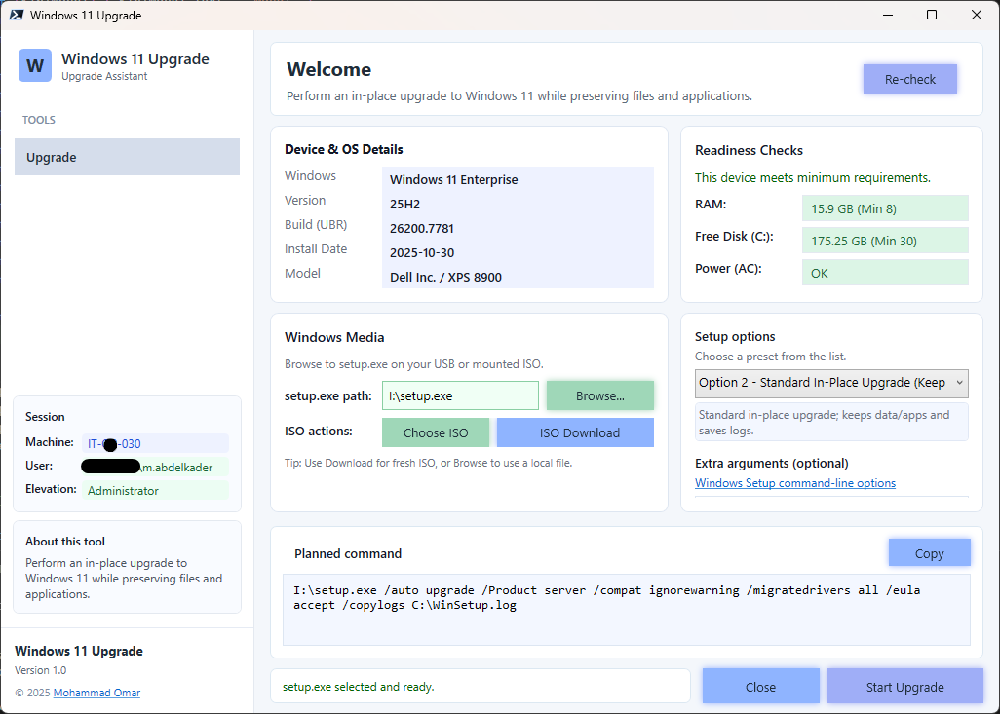

<div align="center">

# 🪟 Windows 11 Upgrade Assistant

**Controlled in-place upgrades to Windows 11**

Check readiness, choose setup media, pick a command profile, and see the full command before you launch Windows Setup. Apps, files, and settings stay in place, and the tool can bypass the hardware checks that block Windows 11 on older PCs.

[](#-usage)
[](https://learn.microsoft.com/en-us/powershell/)
[](#%EF%B8%8F-requirements)
[](#%EF%B8%8F-usage)
[](#-license)
[](#-overview)

[Overview](#-overview) • [Features](#-core-features) • [Usage](#-usage) • [Requirements](#%EF%B8%8F-requirements) • [Troubleshooting](#-troubleshooting) • [License](#-license)

</div>

---

# 📖 Overview

Windows 11 Upgrade Assistant is a WPF tool for an in-place upgrade that keeps your apps, files, and settings. It can also remove the hardware restrictions that stop Windows 11 from installing on a machine without TPM 2.0, Secure Boot, or a supported CPU.

The tool walks you through:

* Quick readiness checks for RAM, free disk space, and AC power
* Validating setup media by pointing at `setup.exe` on a USB stick or mounted ISO
* Mounting an ISO and finding `setup.exe` automatically
* Picking a setup profile with preset command switches
* Showing the exact command in a preview, then confirming it in a separate dialog
* Launching Windows Setup with status messages
* Unmounting the ISO and tidying up when the window closes
* Writing a transcript of each session to `%LOCALAPPDATA%\Win11UpgradeAssistant\Logs\`

---

## 🖼️ Screenshots



*Main window with device and OS details, readiness pills, media validation, setup profiles, and the planned command.*

---

# ✨ Core Features

### 🔹 Device & Readiness
* Shows the Windows edition with build-aware naming for version 22000 and later, plus version, build, install date, and hardware model
* Readiness pills cover RAM (8 GB minimum), free space on C: (30 GB minimum), and AC power, where available. Desktops are fine without AC
* A Re-check button rescans the device. The scan runs on an MTA runspace so slow WMI queries do not freeze the window

### 🔹 Media Validation & ISO Actions
* Browse to `setup.exe`, or clear the field to start over. The field turns green when the filename is valid
* Choose ISO mounts the image and fills in the `setup.exe` path
* Unmount ISO releases the drive letter after the upgrade
* Download ISO opens the official Microsoft Windows 11 download page

### 🔹 Setup Profiles & Command Control
* Three presets:
  * Option 1, Basic, uses a clean-style flow with driver migration
  * Option 2, Standard In-Place Upgrade, is the default and keeps data and apps while logging to `C:\WinSetup.log`
  * Option 3, Silent In-Place Upgrade, runs quietly with no OOBE and no reboot, depending on the media and policy
* The planned command preview shows the exact `<setup.exe> <args>` before anything runs
* Extra arguments let you add other Windows Setup switches, with a link to the official docs
* A confirmation dialog shows the full command with Launch, Copy, and Cancel buttons

### 🔹 Safe Launch Behavior
* If the tool is not elevated, it offers Run as Administrator with Yes, Continue, and Cancel
* Clear messages cover a missing file, blocked execution, access denied, a cancelled UAC prompt, and AppLocker or Defender blocks
* The sidebar shows whether the current session is elevated

### 🔹 Session Logging
* Each run writes a `Start-Transcript` log:

```text
%LOCALAPPDATA%\Win11UpgradeAssistant\Logs\Session_yyyyMMdd_HHmmss.log
```

* The transcript closes and the ISO unmounts when the window closes

---

# 📂 Project Structure

```text
Windows-11-Upgrade-Assistant/
│
├── Windows-11-Upgrade-Assistant-v1.1.ps1      # WPF application source
├── Windows-11-Upgrade-Assistant-v1.1.exe      # Packaged executable
├── Screenshot.png                             # Documentation screenshot
└── README.md
```

---

# 🚀 Usage

### Launch

**Option 1 — PowerShell script:**

```powershell
Set-ExecutionPolicy Bypass -Scope Process -Force
.\Windows-11-Upgrade-Assistant-v1.1.ps1
```

**Option 2 — Packaged EXE (self-signed with PSWrap):**

```text
Windows-11-Upgrade-Assistant-v1.1.exe
```

The EXE was compiled and self-signed with [PSWrap](https://github.com/mabdulkadr/PSWrap), so it runs without a PowerShell console.

### Typical Workflow

1. Launch the tool
2. Review the device details and readiness checks
3. Browse to `setup.exe` on mounted media or a USB stick, or choose ISO to mount one automatically
4. Select a setup profile
5. Optionally add extra arguments
6. Check the planned command preview
7. Click Start Upgrade, review the full command in the dialog, then choose Launch, Copy, or Cancel
8. Optionally unmount the ISO. Closing the window unmounts it and finalizes the log

---

# ⚙️ Requirements

| Requirement | Details |
|-------------|---------|
| **OS** | Windows 10 / 11 |
| **PowerShell** | Windows PowerShell 5.1; version 7 also works |
| **ISO mounting** | Built into Windows |
| **Permissions** | A standard user can open the UI and browse media. Administrator is recommended for launching `setup.exe`. The sidebar shows the current elevation state |

### Files & Logs

```text
Windows-11-Upgrade-Assistant\
├── Windows-11-Upgrade-Assistant-v1.1.ps1
├── Windows-11-Upgrade-Assistant-v1.1.exe
├── README.md
└── Screenshot.png

%LOCALAPPDATA%\Win11UpgradeAssistant\Logs\Session_<timestamp>.log
```

---

# 🔍 Troubleshooting

| Symptom | Likely Cause | Fix |
|---------|--------------|-----|
| "Checks failed" pill stays red | WMI service disabled or no admin rights | Enable `Winmgmt` and rerun elevated |
| ISO mounts but no `setup.exe` path filled | ISO is not Windows installation media | Use a different ISO |
| "Access denied" on launch | Standard user without UAC bypass | Choose Run as admin in the elevation prompt |
| UI freezes when scanning | Fixed in version 1.0.5 with the MTA runspace | Update to version 1.1 |

---

# 🛡 Operational Notes

* Presets can include switches such as `/Product server` and `/compat IgnoreWarning`. Use relaxed compatibility options only if your organization allows them
* Test on pilot devices before a broad rollout
* Make sure the Windows media matches the target language and edition
* Session logs are written unencrypted to a per-user folder. Do not put secrets in the Extra Arguments field
* The background runspace uses MTA on purpose. WMI and CIM are faster there, and the UI thread stays STA

---

## 👤 Author

**Mohammad Abdelkader Omar**  
GitHub: [@mabdulkadr](https://github.com/mabdulkadr)  
Website: [momar.tech](https://momar.tech)  

---

## 📜 License

This project is licensed under the [MIT License](LICENSE).

---

## ⚠ Disclaimer

This skill and every script it generates are provided as-is with no warranty
of any kind. Test generated tools in a staging environment before deploying to
production. The authors assume no liability for any damage or data loss
resulting from their use.

---
<div align="center">

⭐ **If this tool saves you time, star the repo — it helps others find it.**

[Report an Issue](../../issues) · [momar.tech](https://momar.tech)

[](https://www.buymeacoffee.com/mabdulkadrx)

Built with [**PowerShell Enterprise Admin**](https://github.com/mabdulkadr/powershell-enterprise-admin-skill)

</div>
